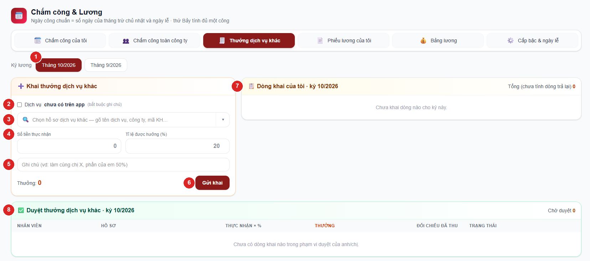
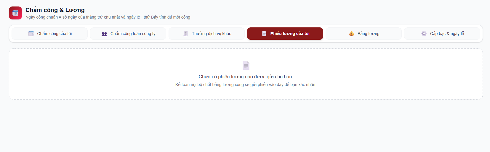
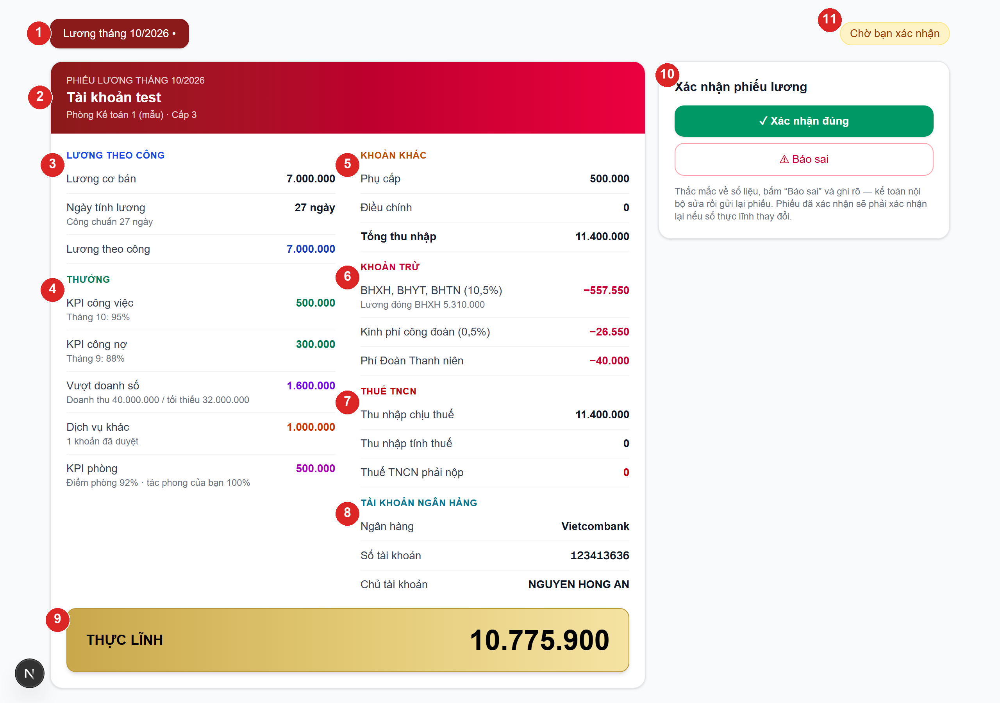
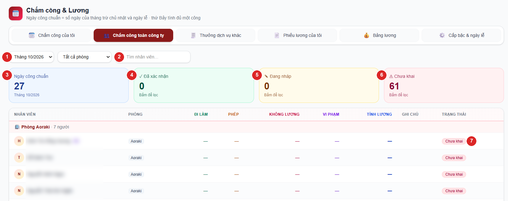

# Chấm công & Lương — Hướng dẫn cho nhân viên

Mục **Chấm công & Lương** ở menu trái dùng để mỗi người **tự khai ngày công hằng tháng**, **khai
thưởng dịch vụ khác** mình đã làm, và **xem / xác nhận phiếu lương** của mình. Trưởng phòng dùng thêm để
kiểm công của phòng và duyệt thưởng. Bảng lương do kế toán nội bộ tổng hợp từ chính những số này — khai
đúng và đủ là lương ra đúng.

Các phần: [chấm công](#phần-1--chấm-công-của-tôi) · [thưởng dịch vụ khác](#phần-2--khai-thưởng-dịch-vụ-khác)
· [phiếu lương](#phần-3--phiếu-lương-của-tôi) · [dành cho trưởng phòng](#phần-4--dành-cho-trưởng-phòng) · [hỏi đáp](#hỏi-đáp).

Số đỏ ①②③… trên ảnh khớp với cột **Số** trong bảng giải thích ngay dưới ảnh.

---

## Lịch hằng tháng — nhớ 4 mốc

| Khi nào | Việc | Ai |
|---|---|---|
| Cuối tháng (ngày làm việc cuối) | Khai ngày công tháng đó rồi bấm **Xác nhận ngày công** | Mọi nhân viên |
| Trong tháng, khi khách đã trả tiền | Khai **thưởng dịch vụ khác** cho kỳ lương tương ứng | Người làm dịch vụ |
| Đầu tháng sau | Kiểm công cả phòng, sửa nếu sai; duyệt / trả lại dòng thưởng | Trưởng phòng |
| Khi kế toán gửi phiếu lương | Mở tab **Phiếu lương của tôi**, bấm **Xác nhận** hoặc **Báo sai** | Mọi nhân viên |

App chỉ cho tự khai **tháng này và tháng trước**. Quá hạn đó thì **không khai được nữa** (trưởng phòng
chỉ sửa được bảng công đã có) — nhớ khai ngay trong tháng, ít nhất cũng **Lưu nháp** trước.

---

## Phần 1 — Chấm công của tôi

Vào menu **Chấm công & Lương** → tab **Chấm công của tôi**.

| Số | Ô | Ý nghĩa |
|---|---|---|
| 1 | **Chọn tháng** | Tháng này / tháng trước. Nhãn góc phải cho biết trạng thái: **Chưa khai** · **Đang nháp** · **Đã xác nhận**. |
| 2 | **Ngày công chuẩn** | Số ngày của tháng **trừ chủ nhật và ngày lễ**. **Thứ Bảy (làm online) vẫn tính đủ một công.** App tự tính. |
| 3 | **Ngày đi làm** | App **tự tính** = công chuẩn − nghỉ phép − nghỉ không lương. |
| 4 | **Nghỉ phép (có lương)** | Ngày nghỉ vẫn được trả lương. Nghỉ nửa ngày gõ `0,5`. |
| 5 | **Nghỉ không lương** | Ngày nghỉ không được trả lương. |
| 6 | **Số lần vi phạm tác phong** | Tự khai. Mỗi lần trừ 20% tác phong của bạn (0 lần = 100%, 2 lần = 60%). Tác phong cả phòng là trung bình mọi người — ảnh hưởng thưởng KPI phòng của cả phòng. |
| 7 | **Ghi chú** | Vd *nghỉ ốm ngày 08*, *vào làm từ ngày 15*. |
| 8 | **Xác nhận ngày công** | Chốt bảng công tháng. Chưa chắc thì bấm **Lưu nháp** bên cạnh. |

Thanh màu ở giữa cho thấy tỉ lệ đi làm / phép / không lương so với công chuẩn; **Ngày tính lương** =
ngày đi làm + nghỉ phép.

### Cách khai (thường chỉ mất 30 giây)

1. Chọn tháng cần khai ①.
2. Gõ số ngày **nghỉ phép** ④ và **nghỉ không lương** ⑤ (nếu có). Ô **Ngày đi làm** ③ tự giảm theo.
3. Gõ **số lần vi phạm tác phong** ⑥ (không có thì để 0).
4. Ghi chú nếu cần ⑦.
5. Bấm **Lưu nháp** nếu chưa chắc — sửa lại thoải mái.
6. Cuối tháng kiểm lại một lần rồi bấm **✓ Xác nhận ngày công** ⑧.

> ⚠ **Xác nhận xong là KHOÁ.** Không tự sửa được nữa. Sai ngày làm hoặc ngày nghỉ thì báo trưởng
> phòng để kiểm tra và cập nhật — mỗi lần trưởng phòng sửa đều phải ghi lý do và được lưu lại.

### Trường hợp đặc biệt

- **Vào làm / nghỉ việc giữa tháng:** gõ tay thẳng vào ô **Ngày đi làm** số ngày thật. Tổng ba ô sẽ ít
  hơn công chuẩn — app **bắt ghi chú lý do** mới cho xác nhận.
- **Tổng ba ô lớn hơn công chuẩn:** app báo đỏ và không cho lưu. Giảm ngày đi làm cho khớp.
- **Ngày lễ trong tháng** đã được trừ sẵn khỏi công chuẩn — không khai ngày lễ vào ô nghỉ.

---

## Phần 2 — Khai thưởng dịch vụ khác

Dịch vụ khác (quyết toán, soát xét sổ, giải thể, thay đổi đăng ký…) được thưởng theo **số tiền khách
đã trả thật** × **tỉ lệ % mình được hưởng**. Một hồ sơ có thể nhiều người cùng làm — **mỗi người tự
khai phần của mình**. Thưởng này **không phụ thuộc doanh số**: chưa đạt doanh thu tối thiểu vẫn được.

Vào tab **Thưởng dịch vụ khác**.

| Số | Ô | Ý nghĩa |
|---|---|---|
| 1 | **Kỳ lương** | Kỳ lương muốn tính khoản thưởng vào (tháng này / tháng trước). |
| 2 | **Dịch vụ chưa có trên app** | Tick khi dịch vụ chưa nhập vào app — gõ tên dịch vụ · tên công ty, **bắt buộc ghi chú**. |
| 3 | **Chọn hồ sơ dịch vụ khác** | Danh sách hồ sơ **đã có tiền thu trên app** của công ty mình phụ trách / thuộc phòng mình. |
| 4 | **Số tiền thực nhận · Tỉ lệ (%)** | Phần tiền của mình và tỉ lệ được hưởng → app tự ra **Thưởng**. |
| 5 | **Ghi chú** | Vd *làm cùng chị X, phần của em 50%*. |
| 6 | **Gửi khai** | Gửi dòng khai cho trưởng phòng duyệt. |
| 7 | **Dòng khai của tôi** | Các dòng đã gửi kỳ này và trạng thái: Chờ duyệt · Đã duyệt · Trả lại. |
| 8 | **Duyệt thưởng** | Chỉ trưởng phòng / quản trị dùng (xem Phần 4). |

### Cách khai

1. Chọn **Kỳ lương** ①.
2. Bấm ô **Chọn hồ sơ dịch vụ khác** ③ (hoặc mũi tên ▾), gõ tên dịch vụ, tên công ty hay mã KH để lọc.

   

3. Chọn xong, app hiện 3 số để đối chiếu: **Phải thu** · **Đã thu trên app** · **Mọi người đã khai**.
4. Gõ **Số tiền thực nhận** và **Tỉ lệ được hưởng** ④ → app tự ra **Thưởng**.
5. Ghi chú nếu làm chung ⑤ → bấm **Gửi khai** ⑥.

Dòng vừa gửi hiện ở khung **Dòng khai của tôi** ⑦ với trạng thái **Chờ duyệt**. Trưởng phòng duyệt thì
thành **Đã duyệt** và mới vào bảng lương; bị **Trả lại** thì xem lý do, xoá dòng đó và khai lại.

> Tổng mọi người khai cho một hồ sơ **vượt số đã thu trên app** thì app cảnh báo (vẫn cho gửi) và
> trưởng phòng sẽ thấy cảnh báo đỏ khi duyệt. Nên ghi tiền thu vào app trước rồi mới khai thưởng.

---

## Phần 3 — Phiếu lương của tôi

Kế toán nội bộ chốt bảng lương xong sẽ **gửi phiếu lương** cho từng người. Vào tab **Phiếu lương của tôi**
— bạn **chỉ thấy phiếu của chính mình**. Chưa có phiếu nào được gửi thì tab hiện như sau:

Khi đã có phiếu (ảnh dưới là **phiếu mẫu**, số liệu minh hoạ):

| Số | Phần | Ý nghĩa |
|---|---|---|
| 1 | **Chọn tháng lương** | Tháng có phiếu đang chờ bạn xác nhận có dấu **•**. |
| 2 | **Tên · phòng · cấp bậc** | Thông tin của bạn trong kỳ lương. |
| 3 | **Lương theo công** | Lương cơ bản × ngày tính lương ÷ ngày công chuẩn. |
| 4 | **Thưởng** | KPI công việc, KPI công nợ (kèm % và tháng lấy số), vượt doanh số, dịch vụ khác, KPI phòng. |
| 5 | **Khoản khác** | Phụ cấp, điều chỉnh (kèm lý do) và **Tổng thu nhập**. |
| 6 | **Khoản trừ** | BHXH 10,5%, công đoàn 0,5%, phí Đoàn 40.000đ — chỉ người tham gia BHXH. |
| 7 | **Thuế TNCN** | Thu nhập chịu thuế · thu nhập tính thuế · **thuế phải nộp** (xem Hỏi đáp). |
| 8 | **Tài khoản ngân hàng** | Ngân hàng, số tài khoản, chủ tài khoản nhận lương. **Sai thì báo ngay** bằng nút Báo sai. |
| 9 | **THỰC LĨNH** | Số tiền chuyển vào tài khoản của bạn = tổng thu nhập − khoản trừ − thuế TNCN. |
| 10 | **Xác nhận phiếu lương** | **✓ Xác nhận đúng** hoặc **⚠ Báo sai**. |
| 11 | **Trạng thái** | Chờ bạn xác nhận · Đã xác nhận · Đã báo sai. |

- Đúng → bấm **✓ Xác nhận đúng**.
- Sai → bấm **⚠ Báo sai**, ghi rõ chỗ sai (vd *thiếu 1 ngày công*, *chưa có thưởng hồ sơ X*, *sai số tài
  khoản*) → **Gửi báo sai**. Kế toán nội bộ sửa rồi gửi lại phiếu, bạn xác nhận lại.
- Phiếu đã xác nhận mà kế toán sửa làm **thực lĩnh thay đổi** thì phải xác nhận lại.

---

## Phần 4 — Dành cho trưởng phòng

Trưởng phòng có thêm tab **Chấm công phòng** và khung **Duyệt thưởng dịch vụ khác**. Trưởng phòng
**thấy ngày công của phòng mình, không thấy lương** của nhân viên.

### Kiểm và sửa công của phòng

| Số | Ô | Ý nghĩa |
|---|---|---|
| 1 | **Chọn tháng** | Mặc định tháng này, xem lại được 6 tháng. |
| 2 | **Tìm nhân viên** | Gõ tên để lọc nhanh. |
| 3 | **Ngày công chuẩn** | Công chuẩn của tháng đang xem. |
| 4 · 5 · 6 | **Đã xác nhận · Đang nháp · Chưa khai** | Bấm vào thẻ để lọc đúng nhóm đó (bấm lần nữa bỏ lọc). Đầu tháng bấm **Chưa khai** để nhắc mọi người. |
| 7 | **Trạng thái từng người** | Danh sách xếp theo phòng, trưởng phòng đứng đầu (nhãn **TP**). |

Nhân viên báo khai sai → bấm **✎ Sửa** ở dòng đó, sửa số ngày hoặc số lần vi phạm, **ghi lý do** (bắt
buộc) → **Lưu**. App lưu lại ai sửa, sửa từ số nào thành số nào, lý do gì. Trưởng phòng **không tự sửa
công của chính mình** — nhờ quản trị.

### Duyệt thưởng dịch vụ khác

Ở tab **Thưởng dịch vụ khác**, khung **Duyệt thưởng dịch vụ khác** (số ⑧ ở ảnh Phần 2) liệt kê dòng khai
của phòng cho kỳ đang chọn.

- Cột **Đối chiếu đã thu**: *khai X / thu Y* — chữ đỏ ⚠ là mọi người đang khai vượt số đã thu. Nhãn vàng
  **Ngoài app** = dịch vụ chưa nhập app, kiểm theo ghi chú.
- **Duyệt** → dòng vào bảng lương. **Trả lại** → bắt buộc ghi lý do.
- Không tự duyệt dòng khai của chính mình.

---

## Hỏi đáp

**Lương của tôi tính thế nào?**
Lương theo công = lương cơ bản × ngày tính lương ÷ ngày công chuẩn. Cộng các khoản thưởng (KPI công
việc, KPI công nợ, doanh số, dịch vụ khác, KPI phòng), phụ cấp và điều chỉnh = **tổng thu nhập**. Trừ BHXH
10,5% + công đoàn 0,5% + phí Đoàn 40.000đ (chỉ người đóng BHXH) và **thuế TNCN** = **thực lĩnh**.

**Thuế TNCN tính thế nào?**
- **Nhân viên chính thức (có đóng BHXH):** thu nhập tính thuế = tổng thu nhập − 15.500.000đ (giảm trừ bản
  thân) − 6.200.000đ × số người phụ thuộc − tiền BHXH bạn đóng. Phần còn lại tính theo biểu lũy tiến:
  đến 10 triệu 5% · trên 10–30 triệu 10% · trên 30–60 triệu 20% · trên 60–100 triệu 30% · trên 100 triệu 35%.
  Thu nhập thấp hơn tổng giảm trừ thì **thuế = 0**.
- **Thử việc / học việc (chưa đóng BHXH):** khấu trừ **10% trên tổng thu nhập**.

**Tôi có người phụ thuộc (con, cha mẹ…)?**
Báo kế toán nội bộ và nộp hồ sơ đăng ký người phụ thuộc. Kế toán cập nhật số người phụ thuộc thì tháng
lương sau được giảm trừ.

**Số tài khoản trên phiếu sai hoặc tôi đổi tài khoản?**
Bấm **Báo sai** trên phiếu, ghi số tài khoản đúng — hoặc báo kế toán nội bộ trước kỳ chốt lương.

**Thưởng KPI phòng tính thế nào?**
Điểm KPI phòng = trung bình 3 tiêu chí: %-công việc, %-công nợ và %-tác phong của phòng. Mỗi người trong
phòng nhận đủ mức: dưới 80% không thưởng · 80–90% được 300.000đ · trên 90% được 500.000đ.

**Thưởng KPI lấy số tháng nào?**
Lương tháng N lấy **%-công việc tháng N** và **%-công nợ tháng N−1** (vd lương tháng 10: công việc tháng 10,
công nợ tháng 9) — đúng số trên Báo cáo KPI. Doanh thu tính thưởng doanh số cũng lấy tháng N.

**Thứ Bảy có phải khai không?**
Không cần khai riêng. Thứ Bảy đã nằm trong ngày công chuẩn và tính đủ một công; nghỉ thứ Bảy thì khai
vào ô nghỉ như ngày thường.

**Tôi lỡ bấm Xác nhận khi chưa khai đủ?**
Báo trưởng phòng sửa giúp (trưởng phòng ghi lý do). Không cần tạo lại.

**Không thấy mục Chấm công & Lương ở menu?**
Đăng xuất rồi đăng nhập lại. Vẫn không thấy thì báo quản trị kiểm quyền "Chấm công" của tài khoản.

**Không thấy hồ sơ dịch vụ khác của mình trong danh sách?**
Danh sách chỉ có hồ sơ **đã ghi tiền thu trên app**. Ghi tiền thu ở mục Dịch vụ khác của công ty trước;
chưa nhập app được thì dùng ô **Dịch vụ chưa có trên app** (bắt buộc ghi chú).
