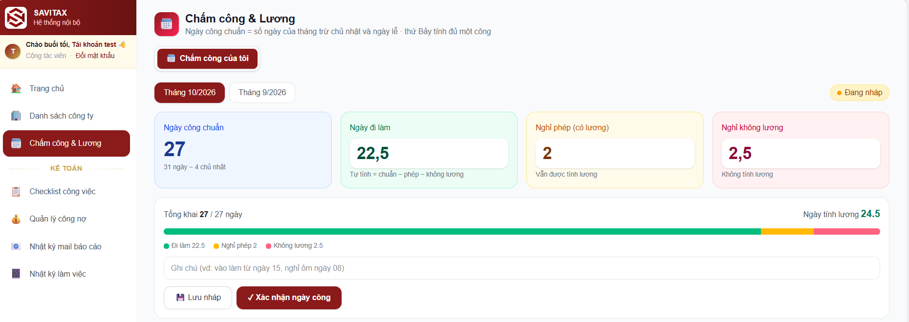
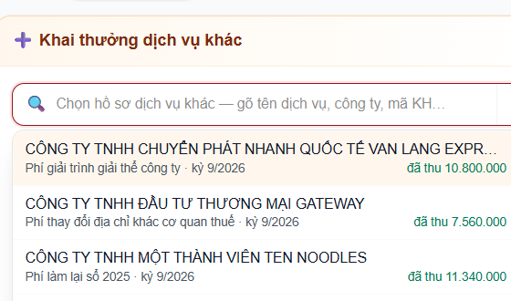

# Chấm công & Lương — Hướng dẫn cho nhân viên

Mục **Chấm công & Lương** ở menu trái dùng để mỗi người **tự khai ngày công hằng tháng** và **khai
thưởng dịch vụ khác** mình đã làm. Trưởng phòng dùng thêm để kiểm công của phòng và duyệt thưởng.
Bảng lương do kế toán nội bộ tổng hợp từ chính những số này — khai đúng và đủ là lương ra đúng.

Ba phần: [chấm công](#phần-1--chấm-công-của-tôi) · [thưởng dịch vụ khác](#phần-2--khai-thưởng-dịch-vụ-khác)
· [dành cho trưởng phòng](#phần-3--dành-cho-trưởng-phòng) · [hỏi đáp](#hỏi-đáp).

---

## Lịch hằng tháng — nhớ 3 mốc

| Khi nào | Việc | Ai |
|---|---|---|
| Cuối tháng (ngày làm việc cuối) | Khai ngày công tháng đó rồi bấm **Xác nhận ngày công** | Mọi nhân viên |
| Trong tháng, khi khách đã trả tiền | Khai **thưởng dịch vụ khác** cho kỳ lương tương ứng | Người làm dịch vụ |
| Đầu tháng sau | Kiểm công cả phòng, sửa nếu sai; duyệt / trả lại dòng thưởng | Trưởng phòng |

App chỉ cho tự khai **tháng này và tháng trước**. Quá hạn đó thì **không khai được nữa** (trưởng phòng
chỉ sửa được bảng công đã có) — nhớ khai ngay trong tháng, ít nhất cũng **Lưu nháp** trước.

---

## Phần 1 — Chấm công của tôi

Vào menu **Chấm công & Lương** → tab **Chấm công của tôi**.

### Các ô trên màn hình

| Ô | Ý nghĩa |
|---|---|
| **Ngày công chuẩn** (xanh dương) | Số ngày phải làm trong tháng = số ngày của tháng **trừ chủ nhật và ngày lễ**. **Thứ Bảy (làm online) vẫn tính đủ một công.** App tự tính, không sửa được. |
| **Ngày đi làm** (xanh lá) | App **tự tính** = công chuẩn − nghỉ phép − nghỉ không lương. |
| **Nghỉ phép (có lương)** (vàng) | Ngày nghỉ vẫn được trả lương. |
| **Nghỉ không lương** (đỏ) | Ngày nghỉ không được trả lương. |

Thanh màu bên dưới cho thấy tỉ lệ đi làm / phép / không lương so với công chuẩn, và dòng **Ngày tính
lương** = ngày đi làm + nghỉ phép.

### Cách khai (thường chỉ mất 30 giây)

1. Chọn tháng cần khai (nút **Tháng này** / **Tháng trước** ở trên).
2. Gõ số ngày **nghỉ phép** và **nghỉ không lương** (nếu có). Ô **Ngày đi làm tự giảm** theo, không
   cần tự trừ. Nghỉ nửa ngày thì gõ `0,5`.
3. Ghi chú nếu cần (vd *nghỉ ốm ngày 08*, *về quê 20–21*).
4. Bấm **Lưu nháp** nếu chưa chắc — sửa lại thoải mái.
5. Cuối tháng kiểm lại một lần rồi bấm **✓ Xác nhận ngày công**.

> ⚠ **Xác nhận xong là KHOÁ.** Không tự sửa được nữa. Sai ngày làm hoặc ngày nghỉ thì báo trưởng
> phòng để kiểm tra và cập nhật — mỗi lần trưởng phòng sửa đều phải ghi lý do và được lưu lại.

### Trường hợp đặc biệt

- **Vào làm / nghỉ việc giữa tháng:** gõ tay thẳng vào ô **Ngày đi làm** số ngày thật (app thôi tự
  tính khi bạn gõ tay). Tổng ba ô sẽ ít hơn công chuẩn — app **bắt ghi chú lý do** (vd *vào làm từ
  ngày 15*) mới cho xác nhận.
- **Tổng ba ô lớn hơn công chuẩn:** app báo đỏ và không cho lưu. Giảm ngày đi làm cho khớp.
- **Ngày lễ trong tháng** hiện thành nhãn tím dưới thanh màu, đã được trừ sẵn khỏi công chuẩn — không
  khai ngày lễ vào ô nghỉ.

Nhãn ở góc phải cho biết trạng thái: **Chưa khai** · **Đang nháp** · **Đã xác nhận**.

---

## Phần 2 — Khai thưởng dịch vụ khác

Dịch vụ khác (quyết toán, soát xét sổ, giải thể, thay đổi đăng ký…) được thưởng theo **số tiền khách
đã trả thật** × **tỉ lệ % mình được hưởng**. Một hồ sơ có thể nhiều người cùng làm — **mỗi người tự
khai phần của mình** với tỉ lệ của mình. Thưởng này **không phụ thuộc doanh số**: chưa đạt doanh thu
tối thiểu vẫn được.

Vào tab **Thưởng dịch vụ khác**.

### Cách khai

1. Chọn **Kỳ lương** muốn tính khoản thưởng vào (tháng này / tháng trước).
2. Bấm vào ô **Chọn hồ sơ dịch vụ khác** (hoặc mũi tên ▾) → danh sách thả xuống hiện các hồ sơ **đã
   có tiền thu trên app** của công ty mình phụ trách hoặc thuộc phòng mình. Gõ tên dịch vụ, tên công
   ty hay mã KH để lọc.

   

3. Chọn xong, app hiện 3 số để đối chiếu: **Phải thu** · **Đã thu trên app** · **Mọi người đã khai**.
4. Gõ **Số tiền thực nhận** và **Tỉ lệ được hưởng (%)** → app tự ra **Thưởng**.
5. Ghi chú nếu làm chung (vd *làm cùng chị X, phần của em 50%*) → bấm **Gửi khai**.

Dòng vừa gửi hiện ở khung **Dòng khai của tôi** với trạng thái **Chờ duyệt**. Trưởng phòng duyệt thì
thành **Đã duyệt** và mới vào bảng lương; bị **Trả lại** thì xem lý do, xoá dòng đó và khai lại.
Dòng chưa duyệt tự xoá được; dòng đã duyệt muốn sửa phải nhờ trưởng phòng trả lại trước.

> Tổng mọi người khai cho một hồ sơ **vượt số đã thu trên app** thì app cảnh báo (vẫn cho gửi) và
> trưởng phòng sẽ thấy cảnh báo đỏ khi duyệt. Nên ghi tiền thu vào app trước rồi mới khai thưởng.

### Dịch vụ chưa có trên app

Tick ô **Dịch vụ chưa có trên app** → gõ **tên dịch vụ · tên công ty** thay cho chọn hồ sơ. Trường
hợp này **bắt buộc ghi chú** (vì sao chưa nhập app, khách trả ngày nào…). Dòng khai có nhãn
*[Ngoài app]* để trưởng phòng kiểm theo ghi chú.

---

## Phần 3 — Dành cho trưởng phòng

Trưởng phòng có thêm tab **Chấm công phòng** và khung **Duyệt thưởng dịch vụ khác**. Trưởng phòng
**thấy ngày công của phòng mình, không thấy lương** của nhân viên.

### Kiểm và sửa công của phòng

1. Tab **Chấm công phòng** → chọn tháng (mặc định tháng này, xem lại được 6 tháng).
2. Bốn thẻ trên đầu: **Ngày công chuẩn** · **Đã xác nhận** · **Đang nháp** · **Chưa khai**. Bấm vào
   thẻ để lọc đúng nhóm đó (bấm lần nữa để bỏ lọc) — đầu tháng nên bấm **Chưa khai** để nhắc mọi người.
3. Nhân viên báo khai sai → bấm **✎ Sửa** ở dòng đó, sửa số ngày, **ghi lý do** (bắt buộc) → **Lưu**.
   Bảng công vẫn ở trạng thái đã xác nhận; app lưu lại ai sửa, sửa từ số nào thành số nào, lý do gì.
4. Trưởng phòng **không tự sửa công của chính mình** — nhờ quản trị.

Danh sách xếp theo phòng, trưởng phòng đứng đầu (nhãn **TP**).

### Duyệt thưởng dịch vụ khác

Ở tab **Thưởng dịch vụ khác**, phía dưới có khung **Duyệt thưởng dịch vụ khác** cho kỳ đang chọn.

- Cột **Đối chiếu đã thu**: *khai X / thu Y* — chữ đỏ ⚠ là mọi người đang khai vượt số đã thu.
  Nhãn vàng **Ngoài app** = dịch vụ chưa nhập app, kiểm theo ghi chú.
- **Duyệt** → dòng vào bảng lương. **Trả lại** → bắt buộc ghi lý do, nhân viên thấy lý do để sửa.
- Không tự duyệt dòng khai của chính mình.

---

## Hỏi đáp

**Lương của tôi tính thế nào?**
Lương theo công = lương cơ bản × ngày tính lương ÷ ngày công chuẩn, cộng các khoản thưởng (KPI công
việc, KPI công nợ, doanh số, dịch vụ khác, KPI phòng), trừ BHXH 10,5% + kinh phí công đoàn 0,5% +
phí Đoàn 40.000đ (chỉ người đóng BHXH). Kế toán nội bộ tổng hợp và gửi bảng lương — nhân viên không
xem bảng lương trên app.

**Thưởng KPI lấy số tháng nào?**
Lương tháng N lấy **%-công việc tháng N−1** và **%-công nợ tháng N−2** — đúng số trên Báo cáo KPI.
Mỗi chỉ số: dưới 80% không thưởng · 80–90% được 300.000đ · trên 90% được 500.000đ.

**Thứ Bảy có phải khai không?**
Không cần khai riêng. Thứ Bảy đã nằm trong ngày công chuẩn và tính đủ một công; nghỉ thứ Bảy thì khai
vào ô nghỉ như ngày thường.

**Tôi lỡ bấm Xác nhận khi chưa khai đủ?**
Báo trưởng phòng sửa giúp (trưởng phòng ghi lý do). Không cần tạo lại.

**Không thấy mục Chấm công & Lương ở menu?**
Đăng xuất rồi đăng nhập lại. Vẫn không thấy thì báo quản trị kiểm quyền "Chấm công" của tài khoản.

**Không thấy hồ sơ dịch vụ khác của mình trong danh sách?**
Danh sách chỉ có hồ sơ **đã ghi tiền thu trên app**. Ghi tiền thu ở mục Dịch vụ khác của công ty trước;
chưa nhập app được thì dùng ô **Dịch vụ chưa có trên app** (bắt buộc ghi chú).
